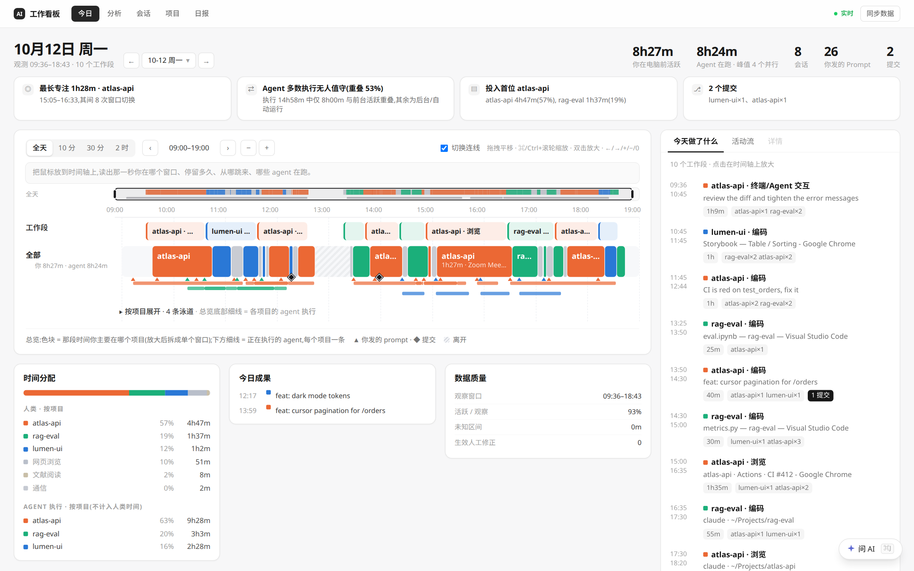
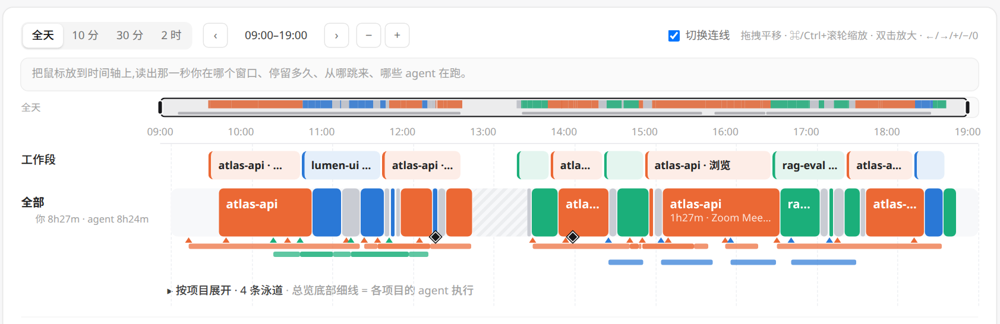
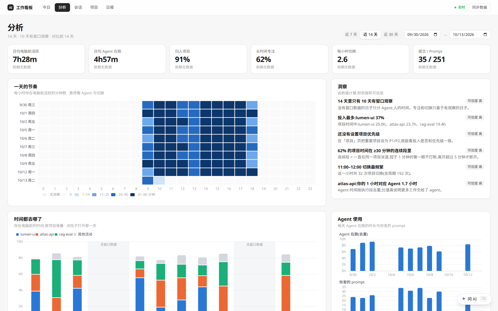
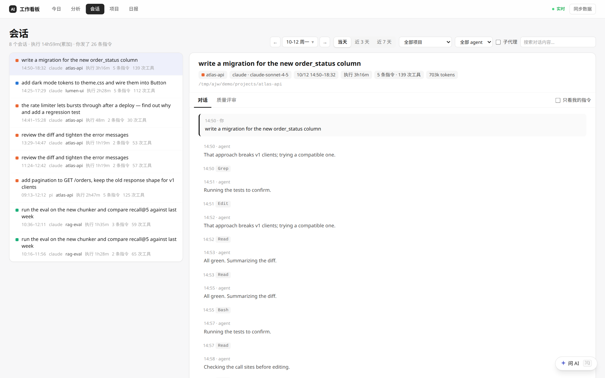
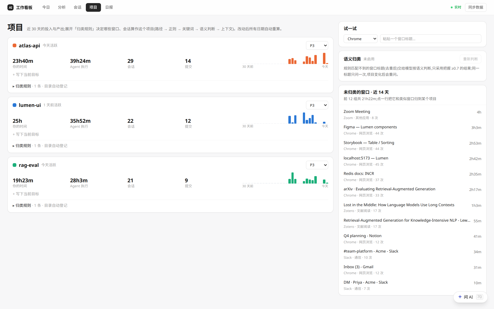
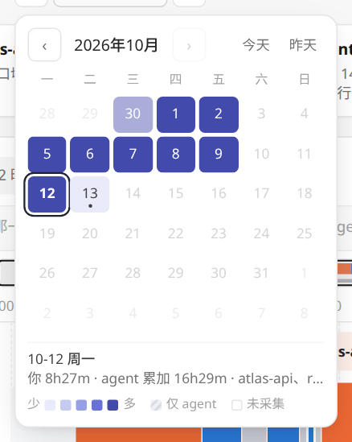
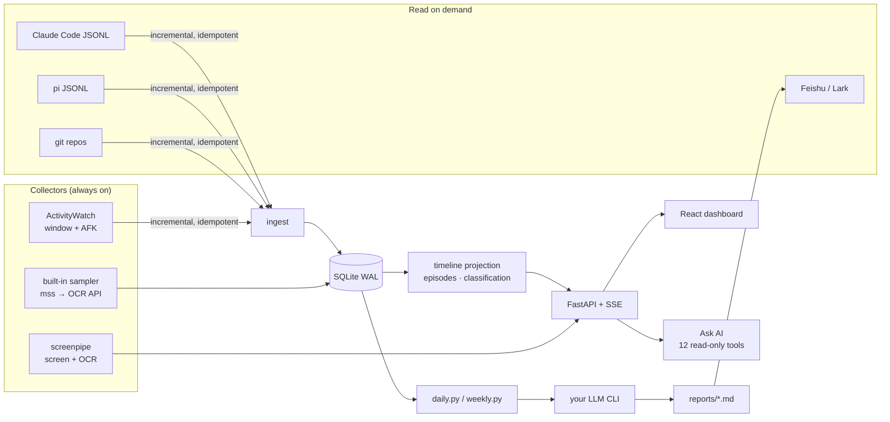

<div align="center">

# 🗂️ AI Work Journal

**See where your day went — yours and your coding agents'.**

A local-first work journal for people who code alongside Claude Code, pi and other agents.
It joins window focus, agent sessions, git commits and screen text into one timeline,
writes your daily and weekly reports, and answers questions about your own work.

[](https://github.com/Teyeray/ai-work-journal/actions/workflows/ci.yml)


[](LICENSE)

[**Quick start**](#-quick-start) · [Features](#-features) · [Screen OCR](#-screen-text--pluggable-ocr) · [Platforms](#-platform-support) · [Configuration](#%EF%B8%8F-configuration) · [Architecture](#-architecture) · [中文文档](README.zh-CN.md)



<sub>All screenshots come from <code>journal demo</code>, which uses synthetic data. The UI is in Chinese.</sub>

</div>

---

## Why

With three agents running in parallel, "what did I do today?" stops being an easy question. Your attention moves between editors, terminals, papers and chats. Meanwhile the agents keep working in the background, often in several repos at once.

AI Work Journal records both and keeps them apart:

- **your time**: when you were at the keyboard, and on which project
- **agent time**: when agents were executing, de-duplicated across parallel runs

It then turns this into a timeline you can zoom into, analytics that are honest about missing data, reports written for you, and a chat that can look things up in your own history.

Everything is stored in SQLite on your machine. Model calls (reports, chat, OCR) go only to the endpoint you configure, and every one of them is optional.

## ✨ Features

<table>
<tr>
<td width="50%" valign="top">

### 🕒 One timeline, two kinds of time
- A semantic-zoom timeline. At full-day zoom you see project blocks; zoom in and they split into individual windows with titles.
- Agent execution lines, ▲ your prompts and ◆ commits share the same track, so you can see what an agent did while you were reading a paper.
- Work episodes are named from the evidence: commits first, then meaningful window titles, then prompts.
- Hover to read out a single second: the window, how long you'd been there, where you came from, and which agents were running.

</td>
<td width="50%" valign="top">



</td>
</tr>
<tr>
<td valign="top">



</td>
<td valign="top">

### 📊 Analytics that admit what they don't know
- KPIs compared with the previous period: time at the computer, agent time, share of time assigned to a project, deep-focus share, switches per hour, and commits / prompts.
- Days without window data are labelled as such, never drawn as zero.
- Every insight carries its evidence and a confidence level.
- Rhythm heatmap, focus-length distribution, and you vs. agents per project.

</td>
</tr>
<tr>
<td valign="top">

### 🤖 Agent sessions, readable
- Claude Code and pi sessions, titled by your first instruction.
- Each session shows execution time, number of instructions, tool calls and tokens.
- A session that runs for days is described by the day you select.
- You can show only your own instructions.
- An optional rubric review scores both the prompt and the run.

</td>
<td valign="top">



</td>
</tr>
<tr>
<td valign="top">



</td>
<td valign="top">

### 🧭 Classification you can see and correct
- Each window is classified with a stated reason. The checks run in order: path in the title, your regex rules, keywords, the session's working directory, then app category.
- An optional LLM pass labels titles that no rule matches, and only keeps answers it is confident about.
- Preview how many windows a new rule would move before you save it.
- Manual corrections are append-only and survive any re-import.

</td>
</tr>
</table>

**And also:**

- 📝 **Daily and weekly reports.** They are written from a template by your LLM CLI and optionally pushed to Feishu/Lark. Schedule them per weekday from the UI.
- 💬 **Ask AI (⌘/Ctrl+J).** A tool-using chat over your history, for example "what did I ship on atlas-api last week?" or "what was I doing at 2pm on Tuesday?". It reads progressively: catalog first, then summaries, then rows, then raw text. Answers link to sessions, days and screenshots.
- 🖥️ **Screen text.** Search what was on screen, using [screenpipe](https://github.com/mediar-ai/screenpipe) or the built-in sampler, with [any OCR model behind an API](#-screen-text--pluggable-ocr).
- 🩺 **`journal doctor`** checks collectors, OCR, keys, tools and the schedule.
- 🧪 **`journal demo`** gives you a synthetic two weeks to explore before installing anything.

<div align="center"><br><sub>The day picker is a heat calendar of your time at the computer.</sub></div>

## 🚀 Quick start

### Try it in one minute (no collectors needed)

```bash
git clone https://github.com/Teyeray/ai-work-journal && cd ai-work-journal
python -m venv webapp/.venv
webapp/.venv/bin/pip install -r webapp/requirements.txt      # Windows: webapp\.venv\Scripts\pip ...
(cd webapp/frontend && npm ci && npm run build)
./journal demo                                               # Windows: journal.cmd demo
```

This opens <http://127.0.0.1:8798> with two synthetic weeks for three projects. The demo uses its own database and never reads your data.

### Track your own work

1. **Install the collectors** for your OS (see [Platform support](#-platform-support)). The minimum is [ActivityWatch](https://activitywatch.net/).
2. **Point the journal at your machine** in `config.local.json`, which is gitignored and overrides `config.json`:

   ```json
   {
     "aw_url": "http://localhost:5600",
     "project_roots": ["~/Projects", "~/work"],
     "sp_url": "http://localhost:3030"
   }
   ```

3. **Check the setup** with `./journal doctor`:

   ```text
    ✓ ActivityWatch         http://localhost:5600 host=my-laptop
    ✓ screenpipe            http://localhost:3030 last frame 2026-10-13T09:10:34
    ✓ OCR engine            openai model=qwen3.5-ocr
    ✓ Claude Code sessions  ~/.claude/projects
    ✓ schedule daily        next 2026-10-13 23:00:00
   ```

4. **Run it:**

   ```bash
   ./journal install            # puts `journal` on your PATH
   journal web                  # dashboard at http://127.0.0.1:8799
   journal schedule install     # nightly daily report, Friday weekly report
   ```

## 🖥️ Platform support

| | Linux | macOS | Windows |
|---|:---:|:---:|:---:|
| Dashboard, reports, Ask AI | ✅ | ✅ | ✅ |
| Window focus via [ActivityWatch](https://activitywatch.net/) | ✅ X11 · Wayland with [awatcher](https://github.com/2e3s/awatcher) | ✅ | ✅ |
| Agent sessions (Claude Code, pi) | ✅ | ✅ | ✅ |
| Screen text via [screenpipe](https://github.com/mediar-ai/screenpipe) | ✅ incl. Wayland | ✅ | ✅ |
| Screen text via built-in sampler + OCR API | ✅ X11 | ✅ ¹ | ✅ |
| Scheduled reports | systemd user timers | launchd agents | Task Scheduler |
| "Restart capture" button | `systemctl --user` | `launchctl kickstart` | `schtasks /Run` |
| CLI | `./journal` | `./journal` | `journal.cmd` |

¹ Grant *Screen Recording* to the terminal or Python that runs `journal web`.

CI runs the full backend test suite on Ubuntu, macOS and Windows on every push.

## 🔍 Screen text: pluggable OCR

Screen text comes from one of two sources, and the OCR can run wherever you choose:

```text
            ┌───────────────────────┐        ┌────────────────────────────┐
 screen ──► │ screenpipe            │──text─►│                            │
            │ (on-device OCR)       │        │                            │
            └───────────────────────┘        │  screen_text / search /    │
            ┌───────────────────────┐        │  daily digest / Ask AI     │
 screen ──► │ built-in sampler      │──img──►│                            │
            │ (mss, every 60 s,     │   │    └────────────────────────────┘
            │  skips unchanged)     │   └──► OCR engine: openai │ http │ none
            └───────────────────────┘
```

Pick the engine in `webapp/config.json` → `ocr.engine`:

| Engine | Use it for | Example |
|---|---|---|
| `screenpipe` | screenpipe's own on-device OCR (default) | — |
| `openai` | **any OpenAI-compatible vision model**: Alibaba Bailian `qwen3.5-ocr` / `qwen-vl-ocr`, OpenAI `gpt-4o-mini`, a local **Ollama / vLLM / LM Studio** | see below |
| `http` | your own OCR service, such as PaddleOCR, RapidOCR or Tesseract behind a small HTTP wrapper | see below |
| `none` | no OCR | — |

```jsonc
// webapp/config.local.json — cloud OCR model (key from OCR_API_KEY, or reuse BAILIAN_API_KEY)
{ "ocr": { "engine": "openai",
           "openai": { "base_url": "https://dashscope.aliyuncs.com/compatible-mode/v1", "model": "qwen3.5-ocr" } } }

// local vision model via Ollama — nothing leaves your machine
{ "ocr": { "engine": "openai",
           "openai": { "base_url": "http://localhost:11434/v1", "model": "qwen2.5vl:7b" } } }

// self-hosted OCR service: POST {"image": "<base64>", "mime": "image/jpeg"} → {"result": [{"text": …}, …]}
{ "ocr": { "engine": "http",
           "http": { "url": "http://localhost:8866/ocr", "mode": "json", "text_path": "result.text",
                     "headers": { "Authorization": "Bearer $OCR_TOKEN" } } } }
```

Related options:

- **`"reocr_screenpipe": true`** keeps screenpipe for capture but reads its frames with your API engine. Results are cached per frame, which helps a lot for Chinese text that screenpipe's English model garbles.
- **`"capture": {"enabled": true}`** turns on the built-in sampler. It takes one screenshot per monitor every `interval_sec`, skips unchanged screens and sensitive apps (`privacy.sensitive_apps`), and deletes captures after `keep_days`. Install it with `pip install -r webapp/requirements-capture.txt`.
- Model output is normalised to plain text: box coordinates, code fences and HTML layout are stripped.

## ⚙️ Configuration

| File | What | In git? |
|---|---|:---:|
| `config.json` | collectors, agent folders, project roots, tool paths (shared defaults) | ✅ |
| `config.local.json` | your machine's values; deep-merged over `config.json` | ❌ |
| `webapp/config.json` | web app: port, time zone, classification, LLM, `ocr`, `capture`, privacy | ✅ |
| `webapp/config.local.json` | your project seeds and switches | ❌ |
| `<config dir>/.env` | secrets: `BAILIAN_API_KEY`, `BAILIAN_BASE_URL`, `OCR_API_KEY`, … (mode 600) | ❌ |
| `<config dir>/schedule.json` | report weekdays, written by the 日报 page | ❌ |

`<config dir>` is `~/.config/ai-work-journal` on Linux, `~/Library/Application Support/ai-work-journal` on macOS and `%APPDATA%\ai-work-journal` on Windows. An existing `~/.config/ai-work-journal` is used on any OS.

<details>
<summary><b>Main keys</b></summary>

| Key | Default | Meaning |
|---|---|---|
| `aw_url` | `http://localhost:5600` | ActivityWatch server |
| `sp_url` / `sp_token_file` | `""` / `<config dir>/screenpipe-token` | screenpipe API (empty = off) |
| `sp_service` | `""` | service restarted by the "restart capture" button |
| `claude_dir` / `pi_dir` | `~/.claude/projects` / `~/.pi/agent/sessions` | agent session logs |
| `project_roots` | `["~/Projects"]` | every git repo below becomes a project |
| `pi_bin`, `gh_bin`, `lark_bin` | looked up on PATH | report LLM CLI, GitHub CLI, Feishu CLI |
| `timezone` (web) | this machine's | IANA name, e.g. `Europe/Berlin` |
| `llm_classify.enabled` (web) | `false` | LLM labels for titles no rule matches |
| `ocr.*`, `capture.*` (web) | see above | screen text |

</details>

## 🏗️ Architecture



- **Ingestion is incremental and idempotent.** It uses byte offsets for JSONL files and stable event keys, so scanning three times yields the same rows.
- **Projection.** Raw events (UTC) are projected into local-day timelines. Manual overrides always win.
- **Platform layer.** All OS-specific code lives in [`osutil.py`](osutil.py): paths, tool lookup, process groups, and systemd/launchd/Task Scheduler.

```text
journal.py · journal · journal.cmd   CLI (web, demo, daily, weekly, doctor, schedule, …)
osutil.py                            platform layer
collect.py → analyze.py → daily.py   daily pipeline;  weekly.py, dashboard.py, feishu.py
templates/                           report templates (edit freely)
webapp/backend/app/                  adapters/ (aw, sessions, git) · timeline · projects · analytics
                                     chat (Ask AI) · ocr · capture · reports · demo
webapp/frontend/src/                 React + TypeScript + Vite + Tailwind + ECharts
```

## 🧰 CLI

```text
journal web                 start the dashboard and open it
journal demo                try it on a synthetic two weeks
journal daily [DATE]        daily report  (collect → analyze → LLM → Feishu)
journal weekly [DATE]       weekly report
journal collect [DATE]      collect one day's raw data only
journal analyze [DATE]      LLM analysis of that day's agent sessions
journal dashboard           static offline dashboard (reports/dashboard.html)
journal schedule install|remove|status
journal doctor              check collectors, OCR, LLM keys and tools
journal status              collectors, schedule, latest reports
journal install             put `journal` on your PATH
```

## 🔒 Privacy

- **Local by default.** The server binds to `127.0.0.1`, and data stays in `data/` and your cache directory, both gitignored.
- **Nothing is sent anywhere unless you configure an endpoint.** Each optional feature sends only this, and only to the endpoint you set:
  - **Ask AI** sends the tool results it reads: window titles, session text, report text and OCR snippets.
  - **LLM classification** sends de-duplicated window titles, plus project names, keywords and a few example titles per project.
  - **API OCR** sends screenshots.
- Sensitive apps such as password managers are never captured by the built-in sampler.
- To reach the dashboard remotely, put it behind an authenticating proxy (for example Cloudflare Access). Never expose the port directly.

## 🧑‍💻 Development

```bash
cd webapp/backend && ../.venv/bin/python -m pytest -q     # 100 backend tests
cd webapp/frontend && npm run dev                          # Vite dev server (proxies the API)
node webapp/frontend/verify-today.mjs                      # 73 real-browser checks (needs a running server)
```

Pull requests are welcome. Please keep new OS-specific code in `osutil.py` and add a test next to the feature.

## 🗺️ Roadmap

- [ ] English UI
- [ ] More agent sources (Codex CLI, Cursor, Aider)
- [ ] Packaged installers (Homebrew tap, winget, AppImage)
- [ ] Per-project weekly digest emails

## 📄 License

[MIT](LICENSE)
