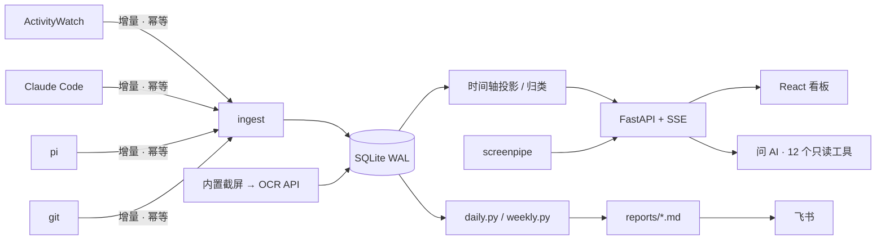

<div align="center">

# 🗂️ AI Work Journal

**你的一天去哪了：你自己的时间，和 coding agent 的时间。**

给和 Claude Code、pi 等 agent 一起写代码的人用的本地工作日志。
它把窗口焦点、agent 会话、git 提交和屏幕文字合成一条时间轴，
自动写日报和周报，还能用自然语言查询自己的工作。

[](https://github.com/Teyeray/ai-work-journal/actions/workflows/ci.yml)


[](LICENSE)

[**快速开始**](#-快速开始) · [功能](#-功能) · [屏幕 OCR](#-屏幕文字可插拔-ocr) · [平台支持](#-平台支持) · [配置](#%EF%B8%8F-配置) · [架构](#-架构) · [English](README.md)


<sub>截图都来自 <code>journal demo</code>，用的是合成数据。</sub>

</div>

---

## 为什么做这个

同时开着三个 agent 干活的时候，「我今天做了什么」就不好回答了。你的注意力在编辑器、终端、论文和聊天窗口之间来回切换，agent 在后台继续执行，而且经常同时在好几个仓库里。

这个工具把两类时间都记下来，并且分开统计：

- **你的时间**：你什么时候在电脑前，在哪个项目上。
- **agent 的时间**：agent 什么时候在执行。多个 agent 并行时去重计算。

在此基础上它提供：

- 一条可以缩放的时间轴
- 会主动说明哪里缺数据的分析
- 自动写好的日报和周报
- 一个能查你自己历史记录的问答

数据都存在本机的 SQLite 里。写报告、问 AI、OCR 这几类模型调用都只发往你自己配置的接口，而且每一项都可以关掉。

## ✨ 功能

- 🕒 **一条时间轴，两种时间**
  - 语义缩放：全天看是项目色块，放大后拆成一个个带标题的窗口。
  - agent 执行细线、▲ 你发的 prompt 和 ◆ 提交画在同一条轨道上，能看到你读论文的时候 agent 在做什么。
  - 工作段按证据命名，优先用提交，其次是有信息量的窗口标题，最后才是 prompt。
  - 鼠标悬停时读出那一秒：在哪个窗口、已经停留多久、从哪里切过来、哪些 agent 在跑。
- 📊 **会说明缺口的分析**
  - 各项指标都和上一个等长周期对比。
  - 没有窗口数据的日子会标出来，不会画成 0。
  - 每条洞察都附带依据和可信度。
  - 另有节奏热力图、专注长度分布，以及每个项目上你和 agent 各投入多少。
- 🤖 **看得懂的 agent 会话**
  - 支持 Claude Code 和 pi，每个会话以你的第一条指令为标题。
  - 显示执行时长、指令数、工具调用数和 token。
  - 跨多天运行的长会话，按你选中的那一天来展示。
  - 可以只看自己发的指令，也可以按固定标准给会话做质量评审。
- 🧭 **可解释、可修正的归类**
  - 每个窗口都标明归到某个项目的原因。判定依次看：标题里的路径、你的正则、关键词、会话目录、应用分类。
  - 规则都匹配不上的标题，可以交给 LLM 判断，只采用把握大的结果。
  - 新规则保存前可以先预览会影响多少窗口。
  - 人工修正只追加不覆盖，重新导入数据后依然有效。
- 📝 **日报和周报**：按模板由你的 LLM CLI 生成，可以推送到飞书。在网页上按星期几设置哪些天生成。
- 💬 **问 AI（⌘/Ctrl+J）**
  - 带工具的对话，可以问「上周 atlas-api 有什么进展」「周二下午两点我在干嘛」这类问题。
  - 渐进式查询：先看目录，再看概要、明细，最后才读原文。
  - 回答里的会话、日期和截图都是可以点的链接。
- 🖥️ **屏幕文字**：通过 screenpipe 或内置截屏搜索屏幕上出现过的文字，OCR 可以[接任意模型 API](#-屏幕文字可插拔-ocr)。
- 🩺 **`journal doctor`**：一条命令检查采集器、OCR、密钥、工具和定时任务。
- 🧪 **`journal demo`**：用两周的合成数据先体验，什么都不用装。

## 🚀 快速开始

### 一分钟体验（不需要任何采集器）

```bash
git clone https://github.com/Teyeray/ai-work-journal && cd ai-work-journal
python -m venv webapp/.venv
webapp/.venv/bin/pip install -r webapp/requirements.txt      # Windows: webapp\.venv\Scripts\pip ...
(cd webapp/frontend && npm ci && npm run build)
./journal demo                                               # Windows: journal.cmd demo
```

会打开 <http://127.0.0.1:8798>，里面是三个项目两周的合成数据。demo 使用独立的数据库，不会读你的任何数据。

### 记录自己的工作

1. 按下面的[平台支持](#-平台支持)表装好采集器，最少需要 [ActivityWatch](https://activitywatch.net/)。
2. 在 `config.local.json` 里写本机的配置。这个文件不进 git，会覆盖 `config.json` 里的同名项：

   ```json
   { "aw_url": "http://localhost:5600", "project_roots": ["~/Projects"], "sp_url": "http://localhost:3030" }
   ```

3. 运行 `./journal doctor`，逐项检查环境，给出有问题的项和修复方法。
4. 安装并启动：

   ```bash
   ./journal install            # 把 journal 放进 PATH
   journal web                  # 看板 http://127.0.0.1:8799
   journal schedule install     # 每晚生成日报、每周五生成周报
   ```

## 🖥️ 平台支持

| | Linux | macOS | Windows |
|---|:---:|:---:|:---:|
| 看板、报告、问 AI | ✅ | ✅ | ✅ |
| 窗口焦点（ActivityWatch） | ✅ X11；Wayland 需要 [awatcher](https://github.com/2e3s/awatcher) | ✅ | ✅ |
| agent 会话（Claude Code、pi） | ✅ | ✅ | ✅ |
| 屏幕文字（screenpipe） | ✅ 含 Wayland | ✅ | ✅ |
| 屏幕文字（内置截屏 + OCR API） | ✅ X11 | ✅ ¹ | ✅ |
| 定时生成报告 | systemd 用户定时器 | launchd | 任务计划程序 |
| 「重启截屏」按钮 | `systemctl --user` | `launchctl kickstart` | `schtasks /Run` |
| 命令行 | `./journal` | `./journal` | `journal.cmd` |

¹ 需要在系统设置里给运行 `journal web` 的终端或 Python 授予「屏幕录制」权限。

CI 每次推送都会在 Ubuntu、macOS 和 Windows 上跑完整的后端测试。

## 🔍 屏幕文字：可插拔 OCR

截屏有两个来源：screenpipe 或内置截屏。识别文字的 OCR 引擎在 `webapp/config.json` 的 `ocr.engine` 里选：

| 引擎 | 适用场景 |
|---|---|
| `screenpipe` | 直接用 screenpipe 自带的本地 OCR（默认） |
| `openai` | 任何 OpenAI 兼容的视觉模型：百炼 `qwen3.5-ocr` / `qwen-vl-ocr`、OpenAI `gpt-4o-mini`，或本地的 Ollama / vLLM / LM Studio |
| `http` | 自建的 OCR 服务，比如套了一层 HTTP 接口的 PaddleOCR、RapidOCR 或 Tesseract |
| `none` | 不做 OCR |

```jsonc
// 百炼(密钥读环境变量 OCR_API_KEY,没设置时复用 BAILIAN_API_KEY)
{ "ocr": { "engine": "openai", "openai": { "base_url": "https://dashscope.aliyuncs.com/compatible-mode/v1", "model": "qwen3.5-ocr" } } }
// 本地 Ollama:截图不出本机
{ "ocr": { "engine": "openai", "openai": { "base_url": "http://localhost:11434/v1", "model": "qwen2.5vl:7b" } } }
// 自建服务:POST {"image": base64, "mime": …},从 JSON 的 text_path 取文字
{ "ocr": { "engine": "http", "http": { "url": "http://localhost:8866/ocr", "text_path": "result.text" } } }
```

几个相关的开关：

- **`reocr_screenpipe: true`**：截屏仍由 screenpipe 负责，但它截到的帧改用你选的 API 引擎识别，结果按帧缓存。screenpipe 自带的是英文 OCR 模型，中文常常识别成乱码，打开这项效果明显。
- **`capture.enabled: true`**：开启内置截屏。
  - 每隔 `interval_sec` 秒给每块屏幕截一张图。
  - 画面没变化时跳过。
  - 前台是敏感应用（`privacy.sensitive_apps`，比如密码管理器）时不截。
  - 截图保留 `keep_days` 天后自动删除。
  - 依赖用 `pip install -r webapp/requirements-capture.txt` 安装。
- 模型返回的文字会统一清理：去掉文字框坐标、代码块标记和 HTML 排版，只留纯文本。

## ⚙️ 配置

| 文件 | 内容 | 进 git |
|---|---|:---:|
| `config.json` / `config.local.json` | 采集器地址、agent 会话目录、项目根目录、工具路径。local 文件会深度合并到前者之上 | ✅ / ❌ |
| `webapp/config.json` / `config.local.json` | 端口、时区、项目归类、LLM、`ocr`、`capture`、隐私设置 | ✅ / ❌ |
| `<配置目录>/.env` | 密钥：`BAILIAN_API_KEY`、`BAILIAN_BASE_URL`、`OCR_API_KEY`，文件权限设为 600 | ❌ |
| `<配置目录>/schedule.json` | 哪几天生成日报，由网页的「日报」页写入 | ❌ |

各系统的 `<配置目录>`：

| 系统 | 路径 |
|---|---|
| Linux | `~/.config/ai-work-journal` |
| macOS | `~/Library/Application Support/ai-work-journal` |
| Windows | `%APPDATA%\ai-work-journal` |

如果 `~/.config/ai-work-journal` 已经存在，任何系统都会优先用它。

**改报告模板**：编辑 `templates/daily.md` 或 `templates/weekly.md`，保存后下次生成就会按新模板输出。模板里的 `{date}` 和 `{label}` 是占位符，要保留。

**飞书推送**：先运行一次 `lark-cli config init --new`，在浏览器里完成授权。之后日报会同时写进飞书文档。

## 🏗️ 架构



所有跟操作系统相关的代码都集中在 [`osutil.py`](osutil.py)：路径、工具查找、进程组，以及 systemd、launchd、计划任务三套定时机制。

## 🔒 隐私

- 服务只监听 `127.0.0.1`。数据存在 `data/` 和缓存目录里，都已加入 `.gitignore`。
- 不配置接口就不会向外发任何数据。配置了的话，各项只发下面这些内容：

  | 功能 | 发送的内容 |
  |---|---|
  | 问 AI | 它查到的窗口标题、会话原文、报告原文和 OCR 片段 |
  | 语义归类 | 去重后的窗口标题，以及项目名、关键词和每个项目的少量示例标题 |
  | API OCR | 截图 |

- 如果要从外网访问看板，前面要加一层带身份验证的代理，比如 Cloudflare Access。不要把端口直接暴露到公网。

## 已知限制

- screenpipe 自带的英文 OCR 识别中文常出乱码，可以打开 `reocr_screenpipe` 改用 API 识别。
- Wayland 不允许普通程序读取屏幕，所以内置截屏在 Wayland 下不可用，要用 screenpipe（它通过系统的屏幕共享授权）。锁屏之后需要重新授权，可以点页面顶部的「重启截屏」。
- ActivityWatch 只能从部署那一刻开始记录，之前的日子没有窗口数据。
- pi 会话目录名是把路径里的 `/` 换成 `-` 得到的，所以原目录名本身带 `-` 时，解析出来的路径只是近似值。

## 🧑‍💻 开发

```bash
cd webapp/backend && ../.venv/bin/python -m pytest -q     # 101 个后端测试
cd webapp/frontend && npm run dev                          # Vite 开发服务器
node webapp/frontend/verify-today.mjs                      # 73 项真实浏览器验收(需服务在跑)
```

## 📄 许可

[MIT](LICENSE)
